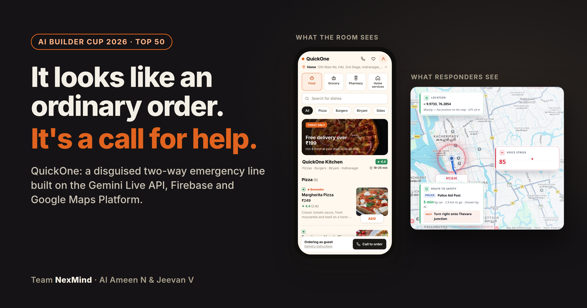
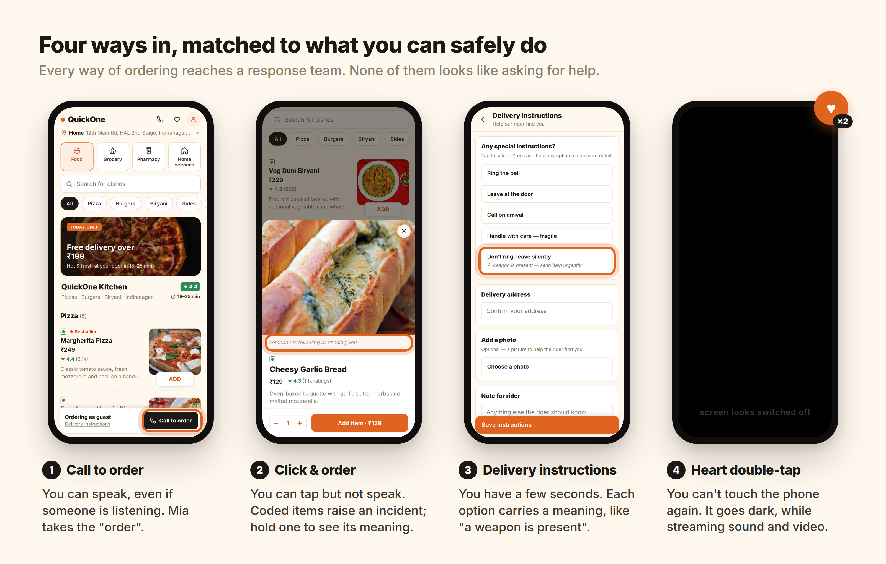
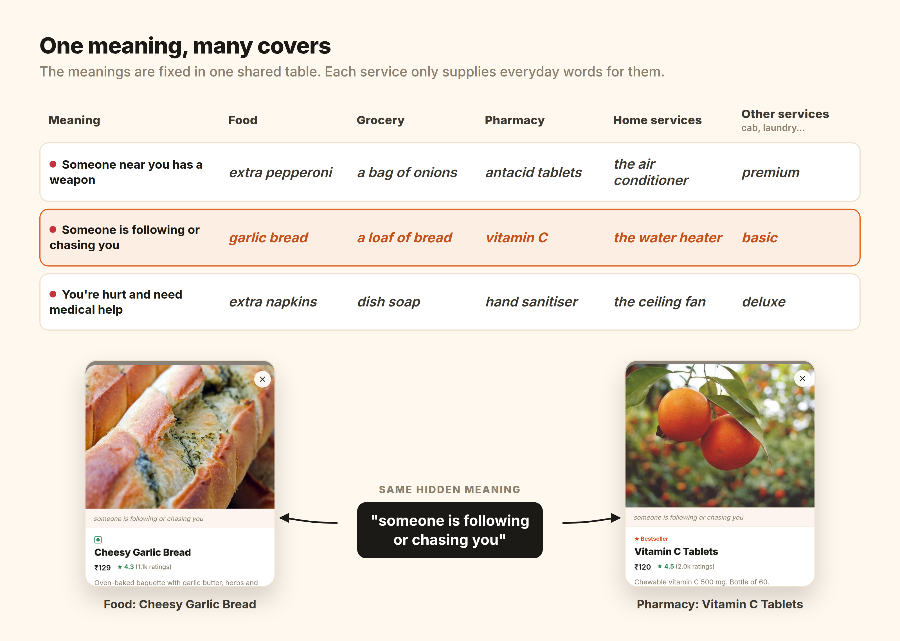
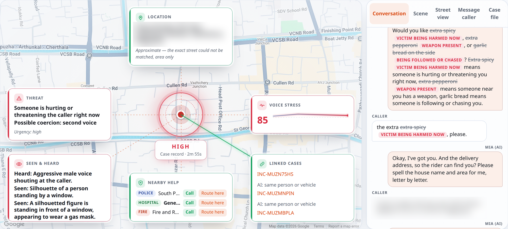
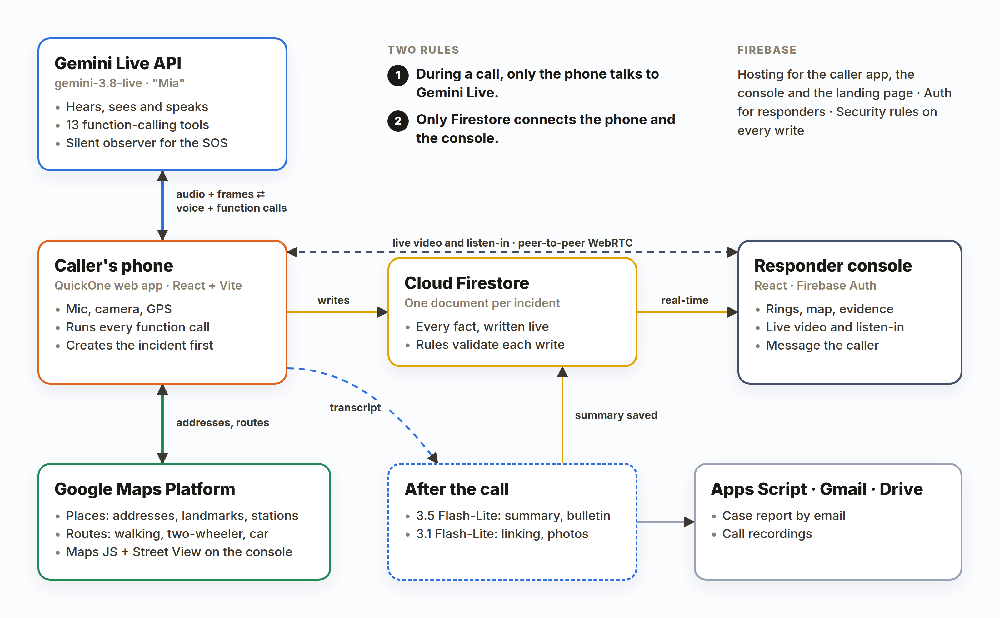
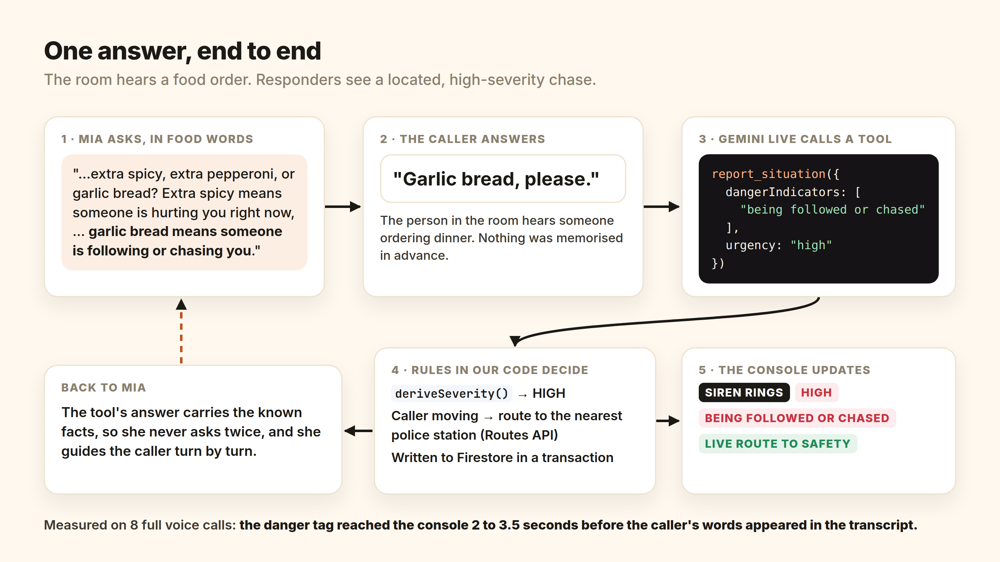
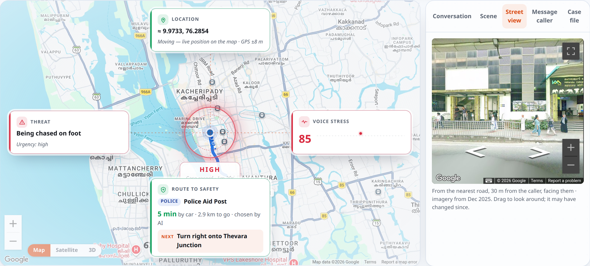

# It Looks Like an Ordinary Order. It's a Call for Help.

## How we built QuickOne, a disguised two-way emergency line on the Gemini Live API, Firebase and Google Maps Platform

*By Team NexMind (Al Ameen N and Jeevan V). AI Builder Cup 2026, Top 50.*


*On the phone, an everyday ordering app. On the responder's screen, a live, located emergency.*

**TL;DR**

- QuickOne looks like an everyday app for ordering food, groceries, medicines or a home repair. Every way of ordering is a hidden line to a response team.
- "Calling to order" reaches Mia, a Gemini Live voice agent who explains what each choice really means while she takes the order. Each answer becomes a function call that reaches a responder within seconds, with a location, a severity and a route to safety.
- Two developers, 300+ commits, 59 test calls costed. We're one of the Top 50 teams going to the Grand Finale in Singapore on 4 December.

## Priya can't dial 112

Picture Priya. Her husband is sitting next to her. He has been drinking, there is a knife on the table, and he is watching her phone.

She can't dial 112: he would hear it. She can't open a safety app: he would see it. Almost every emergency tool assumes that the person asking for help can safely be seen asking.

Priya is a composite, but her situation is common. About one in three women worldwide, [840 million women and girls](https://www.who.int/news-room/fact-sheets/detail/violence-against-women), have experienced physical or sexual violence from a partner, or sexual violence from someone else. India registered [4,41,534 crimes against women](https://theprint.in/india/ncrb-report-out-crimes-against-women-saw-minor-dip-in-2024-maximum-cases-were-cruelty-by-husband/2924248/) in 2024, the largest category being cruelty by a husband or his relatives. In most countries with data, [fewer than 40 per cent](https://unstats.un.org/unsd/gender/chapter6/chapter6.html) of women who experience violence seek help of any kind.

In 2019, a woman in Ohio [called 911 and asked for a pizza](https://www.nbcnews.com/news/us-news/ohio-woman-who-called-911-pizza-was-really-reporting-domestic-n1089636). The dispatcher first thought she had the wrong number, then realised her mother was being assaulted. It worked because one dispatcher guessed right. An official code word can't fix that, because a code everyone knows is a code the abuser knows too.

That is the problem we chose for the AI Builder Cup's Sustainability & Social Impact theme: helping people in danger who can't safely be seen asking for help.

So we asked: **what if the code were taught inside the call, at the moment it's needed, by someone who sounds exactly like a shop taking an order?**

## What we built

QuickOne is a working multi-service app for food, groceries, medicines and home services, each with its own catalog, cart and checkout. To anyone nearby, it's someone ordering dinner. Underneath, four ways in reach a response team, matched to how much the person can safely do:

- **Call to order:** you can speak, even if someone is listening. You reach Mia.
- **Click & order:** you can tap but not speak. Coded items raise an incident, and the order-tracking screen quietly mirrors the responder's progress.
- **Delivery instructions:** you have a few seconds. Each option, like "Don't ring, leave silently", carries a meaning; press and hold to see it.
- **Heart double-tap:** you can't touch the phone again. The screen goes black as if switched off, while the phone streams sound and video and a silent Gemini observer reports what it hears and sees.


*Four ways in, from "I can talk" to "I can't touch the phone again".*

### Mia teaches the code while taking the order

One rule matters more than any other: **every coded question carries its meaning in the same breath.**

> "Would you like extra spicy, extra pepperoni, or garlic bread on the side? Extra spicy means someone is hurting or threatening you right now, extra pepperoni means someone near you has a weapon, garlic bread means someone is following or chasing you."

The caller only says "extra spicy, please," and the person beside her hears her order dinner. In covert mode Mia offers only choices, since an open "what happened?" would force the caller to say something that gives her away. Whatever the caller says aloud is only ever a food word. If the caller says "talk", Mia becomes a plain dispatcher with first-aid steps and directions, and she slips back into the order if another voice comes near. A responder's typed "Stay inside, help is five minutes away" reaches the caller as "Your rider is about five minutes away, please wait inside till he calls."

### One meaning, many covers

We submitted the first version as QuickBite, a food-only app. After the shortlist we noticed something about our own design: because Mia teaches each code live, the code *words* never had to be fixed. Only the *meanings* do.

So QuickBite became QuickOne. The meanings (11 situation codes and 10 follow-up questions) live in one table, and each service is a "cover pack" of everyday words for them. "Someone is following you" is *garlic bread* on a food call, *a loaf of bread* at the grocery, *vitamin C* at the pharmacy, *the water heater* for a repair, and *basic* for a cab. Callers can switch mid-call ("actually, I need medicines"): Mia calls a `set_service` tool and carries on in the new words. Severity, alerts and the console only see meanings, so nothing downstream had to change.


*The meanings never change. Only the words do, so nobody has anything to memorise.*

### What the responder sees

The console rings the moment an incident starts, then fills in live: the threat, the people involved, a voice-stress estimate, what the camera saw and the microphone heard, the location, and the route if the caller is moving. Responders can watch live video, listen in, message the caller and claim the case. Afterwards they get a summary, a dispatch bulletin, the recording and linked cases.


*A test call on the console. Each food phrase is decoded in red: "extra spicy" means the caller is being harmed now. A coercion signal is flagged too, because a second voice asked "Who are you talking to?"*

Disguise isn't new. In 2020, a Polish teenager's fake cosmetics shop, [Rumianki i Bratki](https://www.bangkokpost.com/world/2096987/polish-teens-false-front-beauty-website-helps-victims-of-lockdown-abuse), had psychologists answer coded "orders" from people experiencing abuse. What we add is a live AI voice that answers at any hour and in the caller's language, teaches its own code, and turns what it learns into data a responder can act on.

## Under the hood


*During a call, only the phone talks to Gemini Live, and only Firestore connects the phone to the console.*

**The Google Cloud and Google tools we use:**

- **Gemini Live API (`gemini-3.8-live`):** Mia herself. Voice in and out, camera frames and function calling in one session; it also runs the silent SOS observer.
- **Gemini 3.5 Flash-Lite:** one structured request after each call for the summary, the dispatch bulletin, field confidence and redactions.
- **Gemini 3.1 Flash-Lite:** case linking, reading photos, a backup check on camera frames, and the console's "Ask AI" search.
- **Cloud Firestore and security rules:** the database and the real-time channel, one document per incident. The rules validate every write.
- **Firebase Authentication and Hosting:** responder sign-in and roles, and four hosted sites.
- **Google Maps Platform:** Places for addresses, landmarks and the nearest police, hospital and fire stations; Routes for walking, two-wheeler or car routes; the Maps JavaScript API with a custom Map ID, satellite, 3D and Street View.
- **Apps Script, Drive, Gmail and Google's STUN servers:** recordings, emailed case reports and peer-to-peer live video.
- **Gemma:** the judge in our offline test harness.

Around them sit React, Vite and TypeScript, the `@google/genai` SDK, WebRTC, and a React Native Android port in progress.

## A call, second by second

### Before Mia says a word

Tapping "Call to order" creates the incident in Firestore first (0.11 seconds after the tap in our tests), and only then opens the Gemini Live session. The console rings before the AI says a word, so even a call that drops within seconds leaves responders an incident with a location.

### Why Gemini Live

A disguised emergency call needs one model that hears, sees, speaks and acts in the same session. A speech-to-text, LLM and text-to-speech chain loses *how* something was said and the bang in the background, and adds latency at every hop. Gemini Live takes the raw audio and camera frames and calls functions mid-conversation: in our measured calls, the danger tag reached the console 2 to 3.5 seconds before the caller's words appeared in the transcript.

### Every answer is a function call

Mia never writes a report. Every fact leaves the session as a function call, mid-conversation, through 13 tools: eight that record (the situation, voice stress, camera and sound observations, coercion signals, vehicle plates and more), three whose results she must use (`confirm_address`, `get_route_guidance`, `send_case_report`), plus `end_call` and `set_service`. The phone executes each call, writes the result to Firestore in a transaction, and replies with a "known facts" note, so Mia never asks the same thing twice.


*One answer, end to end. The person in the room hears "garlic bread". The responder sees a high-severity chase with a route.*

### AI proposes, code decides

Gemini extracts what it hears and sees, but **rules in our code make the decisions that matter**. Severity is a plain function anyone can read:

```ts
// shared/incidents/severity.ts (simplified)
export function deriveSeverity(fields, voiceStress) {
  const stress = voiceStress ?? 0
  // affirmed() drops negated tags such as "no weapon" or "not injured"
  const danger = affirmed(fields.dangerIndicators)
  const critical = danger.some((d) =>
    /weapon|gun|knife|gunshot|scream|fire|blood|coercion/i.test(d))
  if (fields.urgency === 'high' || critical || stress >= 80) return 'high'
  if (fields.urgency === 'medium' || danger.length > 0 || stress >= 55)
    return 'medium'
  return 'low'
}
```

Severity never drops during a live call, and the console's recommended action comes from the same rules. The route tool refuses to give directions until the app has seen a "moving" signal, so a caller hiding at home is never told to walk outside. A model can be wrong. Those decisions shouldn't be.

### Tuning a live session for a frightened caller

```ts
// web/src/lib/gemini/liveSession.ts (simplified)
config: {
  responseModalities: [Modality.AUDIO],
  inputAudioTranscription: { customVocabulary,
    languageCodes: ['en-IN', 'ml-IN', 'hi-IN', 'ta-IN'] },
  realtimeInputConfig: { automaticActivityDetection: {
    startOfSpeechSensitivity: StartSensitivity.START_SENSITIVITY_LOW,
    silenceDurationMs: 700,
  } },
  sessionResumption: resume ? { handle: resume } : {},
  contextWindowCompression: { triggerTokens: '48000',
    slidingWindow: { targetTokens: '28000' } },
  mediaResolution: MediaResolution.MEDIA_RESOLUTION_LOW,
}
```

- **700 ms of silence before Mia replies,** so a frightened caller can pause mid-sentence; low start sensitivity, so her own voice from the speaker isn't taken as an interruption.
- **Noise suppression off.** A shout or a bang in the background is evidence.
- **One camera frame every two seconds, at low resolution** (about 70 tokens each): enough to spot a person, a weapon or a plate.
- **Compression on every call.** Without it, [audio-video sessions are limited to 2 minutes](https://aistudio.google.com/docs/live-api/session-management).
- **Resumption with capped reconnects,** so a network blip becomes "sorry, I lost you for a second".
- **Language hints and a custom vocabulary,** because "Vazhicherry" was heard as "veterinary". Mia follows the caller's language; tool arguments stay in English for responders.

### Finding the caller, and the way to safety

GPS drives routing only when it's precise (within 100 m): a laptop's Wi-Fi fix once placed a caller 7.7 km away. Spoken addresses go to the **Places API**, with one safety check: the match has to be in the area the caller named. In one test, "Sunrise Apartments, Kaloor" matched a different building with the same name 3.6 km away, so now a match far from the named area is replaced by the area itself. And if an address can't be found at all, the console says so plainly instead of showing a pin in the wrong place.

For a caller who is followed or chased, the app picks a well-known police station, hospital or fire station nearby, with its phone number, and the **Routes API** returns a walking, two-wheeler or car route. Mia guides turn by turn with distances and landmarks. In covert mode the police station is "where the rider is waiting". The responder follows along on the map and in **Street View**.


*A test chase on MG Road, Kochi: the live route to the nearest police post, and Street View 30 m from the caller.*

When the call ends, a single Gemini Flash-Lite request writes the case summary, the dispatch bulletin and the privacy redactions in one structured answer. Our first version made up to four separate AI requests after every call; merging and trimming them made the case file faster and cheaper. The app then returns to its home screen and removes the call from the browser history, so pressing Back never reveals it.

## What broke, and what it taught us

### 1. Getting a live model to talk exactly once

On `gemini-3.8-live`, tools run asynchronously by default, and each tool response prompts a new reply by default. Mia reports something on almost every turn, so we got 20 or more extra replies per call: repeated or cut-off sentences, and sometimes her reasoning spoken aloud. Answering every tool silently was worse: when her turn was only tool calls, she never went on to answer the caller. The fix uses the `scheduling` field on each function response. In every batch, **exactly one** response may start a reply, and the rest are `SILENT`.

```ts
// web/src/lib/gemini/tools.ts (simplified)
export function batchResponses(calls, outputs, spokeSinceCaller) {
  const isRecord = (c) =>
    SILENT_TOOL_NAMES.has(c.name) || c.name === 'end_call'
  // the one tool Mia must act on; failing that, the last one
  let replyAt = calls.findIndex((c) => !isRecord(c))
  if (replyAt < 0 && !spokeSinceCaller) replyAt = calls.length - 1
  // every other response is SILENT
  return calls.map((c, i) => toolResponse(c, outputs[i], i !== replyAt))
}
```

Two smaller changes went with it. The notes the app sends Mia (what's already known, and whether she's in covert or open mode) used to go out as separate messages; now they ride inside the tool responses she's already waiting for, so they no longer start turns of their own. And her prompt now tells her to make all of a turn's tool calls together, then speak once.

Why it matters: every time the model starts a reply, it runs a fresh inference that re-reads the whole session so far, including Mia's instructions, the call audio and the camera frames. Every call records how many inferences it used. In a short test call with four exchanges, the old behaviour triggered about 22 inferences; after these changes it needs 5 or 6. Fewer competing replies meant far fewer repeated or cut-off sentences, quicker answers for the caller, and a lower cost per call, because every inference is charged for everything it re-reads.

### 2. Rules in the prompt fail sometimes. Rules in code hold.

Each of these began as a prompt rule, failed on a test call, and moved into code:

- Mia started guiding a caller who was hiding at home. The route tool now refuses until the app sees a "moving" signal.
- With no route available, she invented "a police station about 2 km ahead". Now the tool response tells her to name no destination, distance or turn.
- "Petrol pump" was placed at a pump in another city. `confirm_address` now rejects vague places.
- An email was saved from a misheard read-back. It's now saved only after a clear "yes".

### 3. Finding a person in India

Many Indian addresses are landmarks: near the bus stand, opposite the temple. Free OpenStreetMap services gave us rate limits, a public server that began rejecting browser requests, and thin landmark coverage. On Google Maps Platform, in our automated runs, an address resolved in about 200 ms instead of 2 to 4 seconds, "NH 66 near Cherthala bus stand" went from unplaceable to pinned, and "Maharaja's College gate" went from 1.7 km off to about 50 m.

### 4. Making it affordable

98% of our AI cost is the live session, mostly text going in, because every model turn re-reads the session so far, Mia's instructions included. So we cut the turns, cut the prompt from about 52 KB to 22 KB, halved the camera frame rate and compressed the context. Across 59 test calls, AI cost averaged about $0.20 per call at paid-tier prices, or 30 to 35 cents for a full emergency call. Development ran on the free tier.

### Strange things a live model did

- It wrote a Tic-Tac-Toe program in the middle of a call. Code-like output now stops playback and is never saved.
- Hearing Spanish and Malayalam in the background, it said "I'm just a language model and can't help with that." Mia now never breaks character.
- It reported "Seen: black scooter" from a test-pattern camera, which is why camera sightings never set a destination.

## How we test it, honestly

**A test harness.** Seventeen scenarios run a real `gemini-3.8-live` session, with Mia's production prompt and tools, against a simulated caller, from covert calls and chases to coercion, Malayalam and a knife on camera. Strict checks and a Gemma judge score every run. It passed **70 of 88** strict checks (80%). The misses: a gunshot in background audio, a knife on camera, coercion in a flat scripted tone, cover broken in two covert calls, and one false alarm on a genuine order. QuickOne's own cover scenarios include grocery-while-followed (8 of 8) and a food-to-pharmacy switch mid-call (6 of 6).

**Voice calls on the deployed app.** In eight calls with a scripted AI caller, the danger tag reached the console 2 to 3.5 seconds before the transcript line, and a caller who said she was being followed got her first direction about 17 seconds later (median).

**Behind the build**

- **Late September:** the first end-to-end call, then the other three ways in, live video, camera and sound awareness, and the console.
- **Early October:** the test harness, the cost cuts, and dozens of test calls, each fixing what the last one broke.
- **Mid-October:** submitted as QuickBite, 305 commits in.
- **November:** shortlisted for the Grand Finale and mentored by a Google expert. QuickBite became QuickOne, on Google Maps Platform.
- **4 December:** the Grand Finale in Singapore.

**By the numbers:** 4 ways in, 5 cover packs, 11 situation codes, 13 tools, 3 Gemini models, 88 automated checks, 59 calls costed, about $0.20 a call, 321 commits.

## Why it matters

The theme asked for AI that strengthens resilience and community support. For us, that means resilience for people who cannot safely ask for help, and a community that can answer them.

- **It works where other tools give people away:** at home with an abuser, followed on the way home, held against their will, a child in danger, a witness, someone hurt.
- **Responders get a case, not a confused call:** location, severity, threat, route, evidence and a summary, plus hotspot analytics that can help prevent the next one.
- **It's affordable and reachable:** nothing to install on the web, about 20 cents of AI a call, and a voice in the caller's language (tested in English, Malayalam and Hinglish).

**What we don't claim.** Nobody in real danger has used QuickOne yet; it's a prototype we have tested ourselves. It supports emergency services rather than replacing them, and it isn't connected to them yet. Callers are identified by design, not anonymous, so help knows where to go. And the voice-stress score is the model's estimate, not a measurement.

## What's next

- **Hardening on Google Cloud:** ephemeral Live API tokens from a small Cloud Run service (Google's recommended pattern for client-side Live apps), and ADK agents on Cloud Run for dispatch and verification.
- **The Android app,** which plays Mia through the earpiece, so only the caller hears the meanings.
- **A pilot** with an NGO or a police unit, and a hand-off into India's 112 emergency system.
- **Covers that rotate.** Nobody memorises the words, so they can change by region, or even by call.

## From the Top 50 to Singapore

Team NexMind is one of the 50 teams shortlisted for the AI Builder Cup 2026 Grand Finale, and we'll demo QuickOne live in Singapore on 4 December. Thank you to Google Cloud and Hack2skill for the challenge, to Experion Technologies, and to our Google mentor for the feedback that sharpened it.

- The app: [quickbite-5cde0.web.app](https://quickbite-5cde0.web.app)
- The demo videos: [quickbite-5cde0-landing.web.app](https://quickbite-5cde0-landing.web.app/#demo)

## Meet Team NexMind


*Team NexMind: Al Ameen N and Jeevan V.*

- **Al Ameen N:** the caller app, Mia and the Gemini Live conversation, QuickOne's covers, Google Maps.
- **Jeevan V:** the responder console, the real-time incident pipeline, analytics and the test harness.

**Personal guidance:** Venkitesh R Mallan and Jiji O R, with our sincere thanks.

It looks like an ordinary order. It's a call for help.

*In danger? In India, call 112, or 181 for the Women Helpline. Elsewhere, call your local emergency number.*
